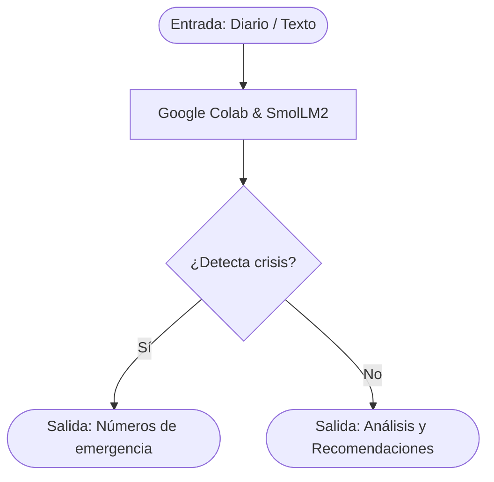

# Proyecto Integrador

  >Falta de acceso inmediato a herramientas de autorreflexión y detección temprana de crisis emocionales para jóvenes universitarios con altos niveles de estrés.

  

**Proyecto integrador · Herramientas de IA**
**Grupo:** [A1 ] · **Equipo:** [ 3]
## 👥 Integrantes

| Nombre Completo     | 
| :------------------ | 
| Paola Meza          | 
| Fernanda Monterubio | 
| Jose Arturo         | 

  

## 1. Caso de uso
>Resolvemos la falta de acceso inmediato a herramientas de autorreflexión y detección
temprana de crisis emocionales para jóvenes universitarios con altos niveles de estrés. El
usuario proporciona fragmentos de su diario personal o texto sobre cómo se siente en el día. A
cambio, el sistema devuelve un análisis cualitativo de su estado de ánimo, identifica distorsiones cognitivas comunes y ofrece recomendaciones personalizadas de apoyo emocional o canalización a líneas de ayuda profesional. 

  

>- **Entrada:** "Siento que por más que estudio y me desvelo para los exámenes, no importa lo que haga, siempre voy a reprobar todo. Ya ni vale la pena seguir intentándolo. "

>- **Salida:** "Lo siento, tu estas enfocado en la evaluacion de los examenes y no puedes superarlo, eso puede causar sentirse frustrado o desatendido. Tome un momento para tomar un vistazo y verificar los pasos que deberias hacer para asegurarte de que estas enfocado en todo el proceso. Te recomendaria hacer un pequeño planificador para alinearte con los objetivos y las rutinas de tu asistencia emocional."

### COMO FUNCIONA:

## 2. Modelo abierto elegido

  

| Dato | Respuesta |
|:----|:---|
| Identificador | [hugging face](https://huggingface.co/HuggingFaceTB/SmolLM2-1.7B-Instruct) |
| Tarea (text-generation ) | `[text-generation ]` |
| Número de parámetros | [1.71 mil millones (1.7B)  ] |
| Licencia | [Apache 2.0  ] |
| Limitación o sesgo declarado|[Sus autores declaran que, debido a los datos de entrenamiento del contenido web, el modelo puede generar respuestas sesgadas o no óptimas en temas sensibles, y no debe utilizarse como sustituto de asesoramiento médico o profesional.]|

  

## 3. Viabilidad de hardware

- **VRAM disponible en Colab:** (15)GB (GPU T4)

- **Dónde se ejecuta:** Directamente en Google collab

- **Por qué:** Porque el modelo solo requiere 3.4GB en FP16, lo cual no sobrepasa la memoria disponible y permite ejecutar todo de forma gratuita dentro del notebook 

  

## 4. Riesgo ético

  

- **Riesgo:** Que el modelo genere diagnósticos erróneos o minimice una crisis severa (ej. ideación suicida).

- **Mitigación:** Implementar una regla estricta de palabras clave (hardcoded guardrail) que detecte crisis e interrumpa al modelo para mostrar directamente números de emergencia profesional, junto con una advertencia visible de que el sistema no es un terapeuta humano. 

## 5. Evidencia

  
